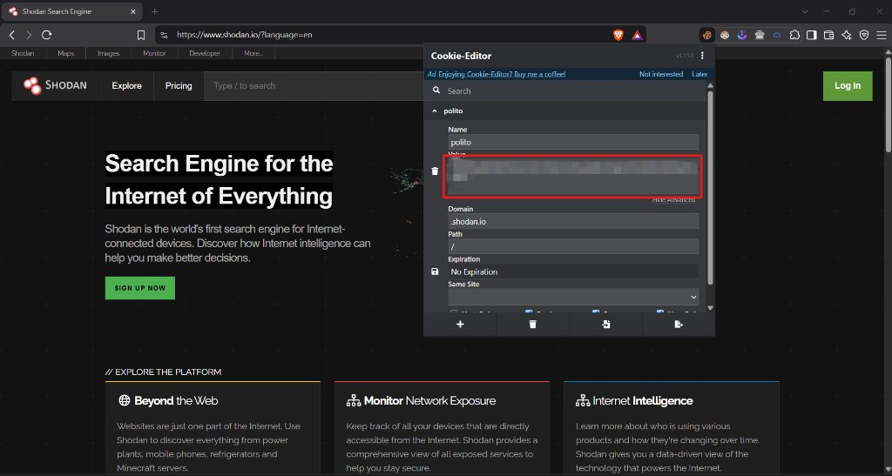

# Shodan IP Address Collector & Scraper

[](https://www.python.org/)
[]()
[](LICENSE)

A high-performance, resilient CLI tool and scraper designed to query **Shodan**, paginate through search result pages, extract valid IPv4 and IPv6 addresses, and save them in real-time to a clean text file (one IP per line).

Supports both **Web Session Cookie scraping** (for free/logged-in browser accounts) and the **Official Shodan REST API** (using an API key).

---

## Key Features

- **Dual Collection Modes**:
  - **Web Scraper Mode**: Uses your browser's authenticated `polito` session cookie to access Shodan search pages directly.
  - **Official API Mode**: Uses Shodan's official Python SDK and REST API for ToS-compliant, structured JSON querying.
- **Resilient Retry & Backoff**: Automatically handles transient Shodan server glitches (`Error 500: Oops, something went wrong`) with exponential retry backoff.
- **Strict IP Validation**: Every discovered IP is validated through Python's standard `ipaddress` library (supports both IPv4 and IPv6) to guarantee zero false positives.
- **Real-Time Disk Sync**: Automatically deduplicates and flushes each discovered IP to disk immediately—no data is lost if interrupted (`Ctrl + C`).
- **Flexible Cookie Ingestion**:
  - Auto-reads from `credential.json` or `cookies.json`.
  - Supports Cookie-Editor multi-line JSON export, Header Strings (`polito=...`), or raw token values.
- **One-Click Cross-Platform Launchers**: Includes `run.bat` for Windows and `run.sh` for Linux/macOS with automatic dependency verification.

---

## Project Structure

```text
├── assets/
│   └── cookie_guide.jpg      # Cookie extraction reference screenshot
├── requirements.txt          # Python dependencies (requests, beautifulsoup4, shodan)
├── run.bat                   # Windows one-click batch launcher
├── run.sh                    # Linux / macOS shell launcher
├── shodan_scraper.py         # Main application script
├── .gitignore                # Protects credentials and collected data
└── README.md                 # Documentation
```

---

## Quick Start

### 1. Windows (One-Click)
Double-click `run.bat` or run in Command Prompt / PowerShell:
```cmd
run.bat
```
*(Automatically verifies Python, installs dependencies from `requirements.txt`, and launches the interactive wizard).*

### 2. Linux / macOS
```bash
chmod +x run.sh
./run.sh
```

### 3. Direct Python Execution
```bash
pip install -r requirements.txt
python shodan_scraper.py
```

---

## Extracting Your Session Cookie (`polito`)

Shodan restricts anonymous/guest search queries. To paginate through search results under your account, provide your browser's `polito` session cookie.

<p align="center">
  
</p>

### Method A: Cookie-Editor Extension (Recommended)
1. Install the **Cookie-Editor** extension in your browser (Chrome, Brave, Firefox, Edge).
2. Log in to [https://www.shodan.io](https://www.shodan.io).
3. Open the Cookie-Editor extension icon and find the cookie named **`polito`** (as shown above).
4. Click **Export** &rarr; **JSON** and save the file as `cookies.json` (or paste into `credential.json`).
   - *Alternatively*, click **Export** &rarr; **Header String** to copy `polito=s%3A...` directly.

### Method B: Browser Developer Tools (F12)
1. Open [https://www.shodan.io](https://www.shodan.io) in your browser and log in.
2. Press `F12` (or right-click &rarr; **Inspect**) to open Developer Tools.
3. Navigate to:
   - **Chrome / Brave / Edge**: `Application` &rarr; `Storage` &rarr; `Cookies` &rarr; `https://www.shodan.io`.
   - **Firefox**: `Storage` &rarr; `Cookies` &rarr; `https://www.shodan.io`.
4. Locate the cookie named **`polito`** and copy its **Value** (e.g., `s%3A...` or hex string).

---

## Configuration (`credential.json`)

To run without pasting your cookie every time, create or edit `credential.json` in the root folder:

### Option 1: Cookie-Editor JSON Array Format
```json
[
  {
    "domain": ".shodan.io",
    "name": "polito",
    "value": "YOUR_ACTUAL_POLITO_COOKIE_VALUE_HERE"
  }
]
```

### Option 2: Standard Key-Value Object Format
```json
{
  "api_key": "YOUR_SHODAN_API_KEY",
  "cookie": "polito=YOUR_ACTUAL_POLITO_COOKIE_VALUE_HERE"
}
```

---

## Command Line Usage (Non-Interactive / Scripting)

You can pass arguments directly to automate scans:

```bash
# Web Scraper mode with auto-loaded cookie:
python shodan_scraper.py -m web -q "port:53,88,135,139,389,445" -p 2 -d 5.0 -o collected-ip.txt

# Web Scraper mode passing cookie string directly:
python shodan_scraper.py -m web -q "apache" -c "polito=s%3A..." -p 5

# Official API mode (recommended for API key owners):
python shodan_scraper.py -m api -q "port:445 country:US" -k "YOUR_SHODAN_API_KEY" -p 3
```

### CLI Arguments Reference

| Flag | Argument | Description | Default |
|:---|:---|:---|:---|
| `-m` | `--mode` | Mode selection: `web` (scraper) or `api` (official API) | `web` |
| `-q` | `--query` | Shodan search query string | Prompted |
| `-c` | `--cookie` | Shodan `polito` session cookie or header string | Reads from file |
| `-k` | `--api-key` | Shodan API key (or `SHODAN_API_KEY` env var) | Reads from file |
| `-p` | `--pages` | Maximum pages to scrape (`0` for unlimited) | `10` |
| `-d` | `--delay` | Delay between consecutive requests in seconds | `2.5` (web) / `1.0` (api) |
| `-o` | `--output` | Destination output file path | `collected-ip.txt` |

---

## Understanding Shodan Search Limits

| Account Tier | Web Search Pagination | Official API Pagination |
|:---|:---|:---|
| **Anonymous (Guest)** | Page 1 only (subject to strict IP rate limits) | N/A |
| **Free Registered Account** | **Pages 1 & 2** (20 results total) | 100 results per query credit |
| **Paid Membership / Academic** | Extended pagination | Based on monthly query credits |

> **Note on Page 3:** If you are using a free registered account, Shodan web limits queries to Page 2. On Page 3, Shodan displays: *"Please purchase a Shodan membership to access more than 2 pages of results."* The scraper detects this automatically and cleanly finalizes all collected IPs.

---

## Security Best Practices

> [!WARNING]
> - **Protect Your Session Tokens**: The `polito` session cookie gives access to your Shodan account. Never publish or commit your `credential.json`, `cookies.json`, or output `.txt` files to a public repository.
> - A `.gitignore` file is included in this repository to prevent accidental credential commits.
> - If you suspect your cookie was leaked, log out of Shodan in your browser immediately to invalidate all active session tokens on Shodan's authentication backend.

---

## Disclaimer

This tool is created for legitimate security research, defensive posture auditing, and authorized system administration. Automated querying of Shodan's web UI is subject to [Shodan's Terms of Service](https://www.shodan.io/terms). For production and large-scale data ingestion, prefer using Shodan's official API (`-m api`).
